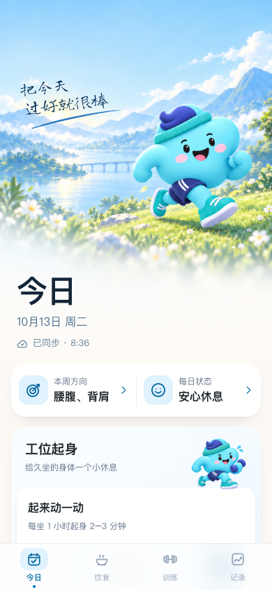
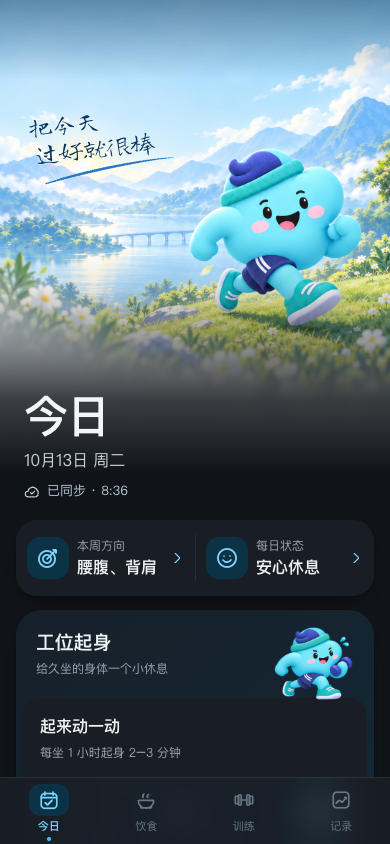
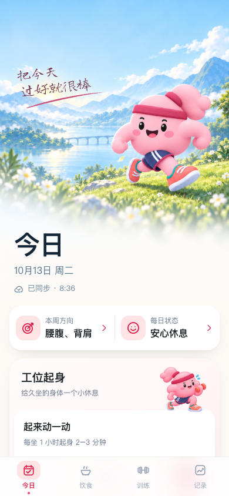
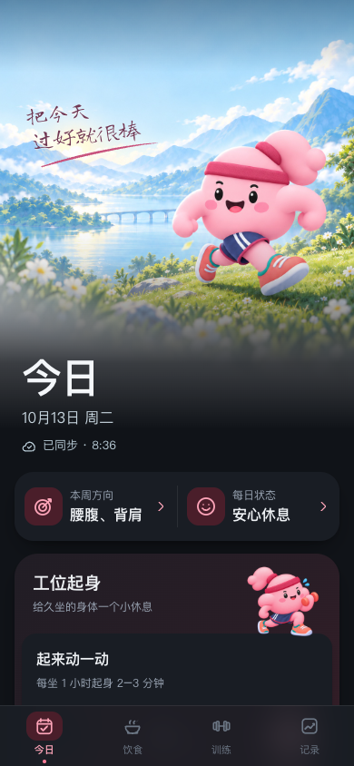

# v48 顶部画布分层

状态：网页布局回归通过，原生状态栏未验证。此次是有代码依据的修复尝试，不标记「灵动岛已修好」。

## 修改前差异与证据

- 用户完全置顶截图（08:36，浅色）：原生状态区奶白，风景从下方硬切；新版无云卡片已经到达设备。
- 用户先前滚动截图（00:10，深色）：场景出现在状态栏后，说明不能笼统认定旧安装永远不可绘制。主题不同，不做像素相减。
- 确认稿 `../page-header-proposal/spec/proposed-today-390@3x.png`：天空延续到系统状态区。当前网页同视口图见下表；浏览器截图不含 iOS 状态区。
- 可执行差异：撤掉已失败的屏幕高度差偏移；排除 html/body 不透明背景色这个取色来源；普通文档里的正文背景保留。保留图片和自然滚动，避免强制滚动引入跳动。

## 原因置信度

不透明 body 背景和失效偏移已由代码确认；其与用户设备白栏的因果尚未由真机证实。

参考：[WebKit 固定容器取色实现](https://github.com/WebKit/WebKit/blob/main/Source/WebCore/page/LocalFrameView.cpp)、[WebKit 305546 的取色／滚动问题](https://bugs.webkit.org/show_bug.cgi?id=305546)、[HawkShift iOS 26 实测](https://hawkshift.com/research/ios-26-safari-status-bar)。后者测试的是 Safari 标签页，并非主屏幕 App，不能直接外推为本次修复证明。

## 相同 390×844 合成数据前后对照

| 状态 | 修改前 | 修改后 |
| --- | --- | --- |
| 蓝浅 |  |  |
| 蓝深 |  |  |
| 粉浅 |  |  |
| 粉深 |  |  |

背景湖山／厨房／运动室／双人记录、手写字体及线条、角色主体／姿态／帽子／衣服、道具和装饰：资源路径与修改前一致。标题日期同步、正文首卡位置在 32 组中完全一致。底边仍使用原有渐隐。卡片继续沿用 v47 渐变。

`node docs/qa/status-canvas-v48/check.cjs after`：四页×蓝粉×浅深×320/390，32 组图片解码、无横溢、正常滚动回顶、离线同步提示、长手写文本状态。前后测量见 before.json / after.json。没有生成伪造原生状态栏截图。

设计系统、页面状态、餐食、SW、启动首帧／缓存／冷启动／身份选择／恢复错误回归全部通过。发布结果记录在维护历史。

## 真机验收标准

原桌面图标打开，完全置顶、未滚动时，天空直接出现在时钟与灵动岛后；轻微滚动及返回顶部没有重新出现纯色条。四页、蓝粉和浅深均按此标准。若仍失败，继续标记未解决，不归因为用户操作或图标。
