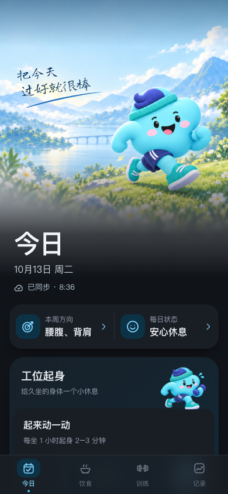

# v49：iOS 首屏滚动状态

状态：修复实现与网页行为检查；原生状态栏仍需真机验收。

## 证据与版本回查

- 用户 08:50 截图证明 v48 仍有白条；滚动后图片能显示的反馈保留，不再把背景透明等同于首屏图片已经被系统绘制。
- 回查 `8c5c29f`（v43）与 `6c8ae86`（v44）：v43 让原先连续渐变的顶部底色、html/body 和 theme-color 一致；v44 换为独立图片表头。旧成功效果不能证明 iOS 曾在零滚动处绘制同一张图片。
- [第一手真机排查](https://vibing.inc/guides/ios-safari-white-bar-fix) 记录零滚动时使用底色、滚动后才合成内容，并提出预留少量滚动行程。结合用户现象，本轮直接验证非零滚动状态。资料场景是 Safari，主屏幕 App 的具体行为仍待用户真机验证，不能承诺 1px 必然足够。

## 可执行修改与视觉清点

iOS 主屏幕场景容器顶部增加 1px，首开滚至 1px，保持英雄图、手写句、标题、日期、同步和首卡在原视口位置。四页共用。普通浏览器停在 0，不用屏幕高度推算安全区，不添加一整块状态栏占位。

实际图片文件、人物轮廓／姿态／帽子／裤边、道具、手写字和装饰均未更换。下缘渐隐与卡片渐变保持原样。相同 390×844 合成数据对照：

| 主题 | v48 | v49（iOS 模式网页截图） |
| --- | --- | --- |
| 蓝浅 |  |  |
| 蓝深 |  |  |

这些截图不包含原生状态栏，不是白条已消失的证据。用户私人截图不加入公开仓库。

## 行为验证

`node tests/status-scroll-browser.js`：32 组主屏幕与 32 组普通浏览器，四页×320/390×蓝粉×浅深；图片解码、原几何位置、无横溢、正常阅读位置不跳动、手指拖动期间不调整、滚动结束回顶、弹窗期间不调整、切页回顶。

`DUOFIT_TEST_IOS_STANDALONE=1` 运行既有 `tests/startup-browser.js`：缓存／冷启动／本机／跳过／减少动态／未登录／恢复错误路径。仅真正进入主页面的路径才预设 1px。

设计系统、场景、餐食、SW 回归及 diff 检查一起运行。无 config、记录 ID、角色格式或用户数据修改；核心版本 v49，独立图片缓存保留。

## 真机验收

原桌面图标打开，未手动滚动时场景出现在时钟／灵动岛后；返回顶部与切页同样连贯。若白条仍在，标记本方案未解决，不能从网页的 scrollY=1 断言系统合成成功。
